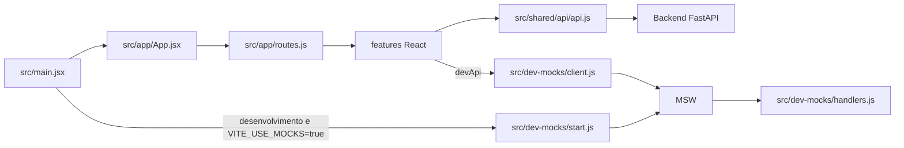

# Arquitetura do Frontend

Este documento descreve a arquitetura presente no código funcional do commit **c47346a**. O HEAD **c05d282** acrescenta documentação. Para a visão funcional, consulte [Funcionalidades](FUNCIONALIDADES.md); para formatos e rotas, [Contratos da API](CONTRATOS_API.md).

## Plataforma e entrada

- React 18 com JavaScript/JSX, Vite 6 e Tailwind CSS 3.
- [main.jsx](../src/main.jsx) monta a aplicação sob StrictMode e ErrorBoundary. O app usa rotas próprias por hash, sem React Router.
- [App.jsx](../src/app/App.jsx) compõe o menu, conteúdo e limites de erro por página. [routes.js](../src/app/routes.js) declara rótulos, menu e componentes; páginas são carregadas sob demanda.
- [ManagerSession.jsx](../src/shared/auth/ManagerSession.jsx) controla sessão do gestor. O JWT fica em sessionStorage, é validado por /auth/me na recarga e removido no logout ou em 401. Guardas React melhoram a navegação, enquanto a autorização real é feita pelo Backend.
- O tema usa localStorage; formulários, filtros e carregamento usam hooks locais. Não há Redux nem biblioteca externa de roteamento.

## Camadas

| Camada        | Responsabilidade                                                                                          |
| ------------- | --------------------------------------------------------------------------------------------------------- |
| app           | Entrada, rotas, layout, tema, erros e composição transversal                                              |
| features      | Páginas, hooks, componentes e lógica de auth, dashboard, colaboradores, relatórios, configurações e Tasks |
| shared/api    | Cliente HTTP, timeout, cancelamento, Bearer e validação das respostas                                     |
| shared/lib    | Datas, duração, equipe, status e estado de falha                                                          |
| dev-mocks     | Cliente e handlers de demonstração isolados do build de produção                                          |
| testing / e2e | Vitest/Testing Library e Playwright                                                                       |

Dependências permitidas: app pode compor features e shared; features podem usar shared e seu próprio módulo; shared não depende de app nem de features. O ESLint contém regras de fronteira de arquitetura.

## Comunicação com a API

[api.js](../src/shared/api/api.js) é o cliente HTTP de produção. Ele define timeout de 15 segundos, AbortController, mensagens seguras para falhas HTTP, validação de payload/resposta e leitura 204 sem corpo. Sessão ausente gera erro 401 local; resposta 401 em rota autenticada encerra a sessão. 403 permanece distinto de 401.

As telas solicitam dados independentes em paralelo e preservam respostas parciais quando outra fonte falha. Hooks cancelam consultas ao trocar filtros ou sair da página e descartam respostas antigas. Cancelar no cliente não desfaz uma mutação já processada pelo servidor.

As rotas reais do CRUD de Tasks, usuários, realtime, resumo e exportações exigem JWT de gestor e filtram pelo gestor no Backend local. /config/* e /categories/* permanecem globais e não exigem token, embora o cliente web envie Bearer para /config/. O Frontend não consome /categories/*. Ver [Pendências Backend](PENDENCIAS_BACKEND.md) para decisões e lacunas de segurança.

## Autenticação e tarefas

O cadastro e login usam /auth/register e /auth/login. Depois do login, o Frontend valida o JWT em /auth/me antes de expor as páginas. A sessão contém o perfil do gestor e o código de associação. A audiência de gestor é diferente da audiência do Agent.

Tasks em produção usam CRUD autenticado da API e carregam colaboradores por /users/. O seletor só oferece IDs UUID da equipe retornada; o Backend confere os IDs novamente no salvamento. Associar colaborador a uma Task não inicia a captura do Agent.

## Dados do Dashboard

Dashboard consulta resumo diário, colaboradores e atividade realtime como fontes separadas. Os filtros podem selecionar data, usuário, aplicação e Task, mas apenas parâmetros aceitos pelo endpoint afetam consultas de produção. O filtro e o card de analytics por Task continuam sem agregação real: o adaptador não chama rota inexistente em produção.

Os estados online, ausente e offline são recebidos do Backend. A classificação pode depender de idade de captured_at e is_idle; não é prova de conectividade do Agent. Sem linha recente, a aplicação apresenta “Sem dados”, sem transformar ausência em zero.

## Mocks de desenvolvimento

Mocks iniciam somente quando o build é de desenvolvimento e VITE_USE_MOCKS=true. O app monta depois de iniciar o Service Worker; se a inicialização falha, informa o problema em vez de trocar silenciosamente para a API real. Os handlers oferecem autenticação e equipe fixas, CRUD de Tasks em memória e respostas candidatas de analytics. O resumo simulado não comprova persistência nem contrato real.

O verificador de produção [verify-production-bundle.mjs](../scripts/verify-production-bundle.mjs) impede handlers, worker e rotas demonstrativas no bundle. Em produção, a fonte de analytics por Task retorna indisponível até existir contrato real.

## Interface e qualidade

O layout adapta menu e tabelas a telas estreitas, inclui navegação por teclado, foco visível, link para pular conteúdo e preferência por movimento reduzido. Playwright cobre fluxos e larguras configuradas; axe-core procura violações automatizáveis. Leitor de tela, zoom nativo, dispositivos reais e API real exigem validação manual ou homologação; consulte [Testes](TESTES.md) e [Pendências Frontend](PENDENCIAS_FRONTEND.md).

Não há manifest nem service worker de produto; a aplicação não é PWA nem oferece política offline.
