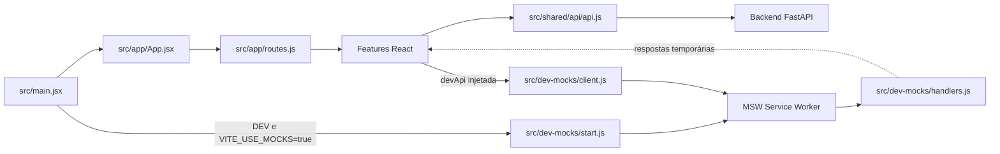

# Arquitetura do frontend

Este documento descreve o código executado atualmente em `FrontEnd/`: estrutura, dependências entre camadas e fluxos de interface. [Funcionalidades](FUNCIONALIDADES.md) relaciona as telas aos requisitos; [Contratos da API](CONTRATOS_API.md) registra rotas, payloads, validação e comportamento HTTP; [Pendências](PENDENCIAS.md) separa o que depende de novos contratos do backend.

## Plataforma e entrada

- React 18 com JavaScript/JSX, Vite 6, Tailwind CSS 3 e CSS local. Vitest e React Testing Library cobrem os componentes e hooks; Playwright verifica fluxos no navegador.
- `index.html` declara `lang="pt-BR"`, viewport e `#root`. `src/main.jsx` monta `App` sob `React.StrictMode` e `ErrorBoundary`.
- `ErrorBoundary` global mostra uma mensagem e opção de recarregar após exceção de renderização. `PageErrorBoundary` isola cada rota. Falhas HTTP são tratadas nas páginas e hooks de dados.
- `src/app/App.jsx` compõe `Sidebar`, conteúdo principal e páginas carregadas com `React.lazy`/`Suspense`. `src/app/routes.js` reúne label, título, menu e componente de cada rota. `useHashRoute` observa `hashchange` e consulta o guarda de saída quando há alterações não salvas. Hash vazio abre o painel; hash desconhecido produz a página não encontrada. `#/login` e `#/cadastro` usam o layout próprio de `AuthPage`.
- `App` ajusta `document.title` por rota e mantém uma única instância de `useTheme`. O hook usa `timetracker-theme` no `localStorage`; sem preferência salva, consulta `prefers-color-scheme`.

## Mocks de desenvolvimento

`src/main.jsx` só carrega `dev-mocks/start.js` e `dev-mocks/client.js` quando `import.meta.env.DEV` e `VITE_USE_MOCKS=true`. Os imports são dinâmicos e a aplicação só monta depois que o Service Worker inicia. Falha de import ou inicialização mostra um alerta com opção de nova tentativa; quando mocks foram solicitados, a interface não troca para chamadas reais. Handlers conhecidos simulam as rotas implementadas e uma rota final responde `501` para endpoints da API sem mock; outros requests não tratados na origem configurada causam erro MSW em vez de bypass ao Backend. Em desenvolvimento sem mocks, um módulo de limpeza remove apenas registros do `mockServiceWorker.js` deste app e recarrega a página se o worker antigo ainda controla a aba.

As ramificações simuladas de autenticação, Tasks e jornada também verificam `import.meta.env.DEV`. O cliente dos mocks usa `requestValidated` do cliente HTTP compartilhado, então mantém timeout, cancelamento e erros de rede/HTTP/schema. `handlers.js` fornece autenticação e colaboradores fixos para demonstração, CRUD de Tasks em memória e um resumo por Task sem métricas (`tasks: []`). Essa implementação não confirma contratos do Backend nem grava dados. O build de produção omite os módulos e componentes simulados, e `scripts/verify-production-bundle.mjs` verifica artefatos conhecidos.

## Mapa do código

- `app/`: composição das páginas, layout, navegação por hash, tema, barreiras de erro e estilos globais. `src/main.jsx` permanece como entrada do Vite.
- `features/`: funcionalidades `auth`, `collaborators`, `dashboard`, `reports`, `settings` e `tasks`. Cada funcionalidade mantém componentes, hooks, bibliotecas e páginas próprios quando necessário.
- `shared/`: cliente HTTP, componentes usados por várias telas e funções comuns coesas de validação/apresentação. `shared/lib/` agrupa datas, duração, equipe, status e falhas de requisição; cálculos do resumo ficam em `features/dashboard/lib/summary.js`.
- `testing/`: setup do Vitest e testes que atravessam mais de uma funcionalidade. Testes específicos ficam junto do arquivo testado.

`app` pode importar `features` e `shared`; cada funcionalidade pode importar `shared` e seus próprios arquivos. `shared` não deve depender de `app` ou `features`. A regra local em `lint/architecture.js` verifica imports relativos, reexports e imports dinâmicos literais em `npm run lint`. Imports de pacotes externos ficam fora dessa regra. Use imports diretos, inclusive nos imports dinâmicos das páginas, sem arquivos de reexportação.

| Caminho                                                                              | Responsabilidade                                                                                                                                                          |
| ------------------------------------------------------------------------------------ | ------------------------------------------------------------------------------------------------------------------------------------------------------------------------- |
| `src/shared/api/api.js`                                                              | Cliente HTTP único, timeout, cancelamento, parâmetros, downloads e contratos isolados de autenticação.                                                                    |
| `src/shared/api/validators.js`                                                       | Validação das respostas de usuários, realtime, resumo, configurações e schemas públicos do gestor/JWT.                                                                    |
| `src/shared/lib/date.js`, `duration.js`, `team.js`, `activityStatus.js`              | Funções reutilizadas para datas, duração, equipe e rótulos de status.                                                                                                     |
| `src/features/dashboard/hooks/useDashboardData.js`                                   | Estado e atualização das fontes do painel: resumo, usuários e realtime.                                                                                                   |
| `src/features/dashboard/hooks/useAutoRefresh.js`                                     | Atualização periódica apenas com a aba visível e atualização ao retornar.                                                                                                 |
| `src/features/dashboard/lib/summary.js`                                              | Soma de duração e consolidação de categorias do painel.                                                                                                                   |
| `src/features/dashboard/pages/DashboardPage.jsx`                                     | Composição de filtros, indicadores, atividade e categorias.                                                                                                               |
| `src/features/dashboard/components/AssociationCodeCard.jsx`                          | Card acessível no Dashboard autenticado; estado do código isolado e consulta real pendente do Backend.                                                                    |
| `src/features/collaborators/hooks/useCollaboratorsData.js` e `components/`           | Consultas, combinação de usuários/realtime e visualização responsiva.                                                                                                     |
| `src/features/settings/hooks/useSettings.js` e `components/SettingsForm.jsx`         | Leitura, edição, validação, gravação e guarda de alterações não salvas.                                                                                                   |
| `src/features/reports/`                                                              | Página, consulta de usuários e exportação organizadas por responsabilidade.                                                                                               |
| `src/features/auth/pages/AuthPage.jsx`, `src/features/tasks/pages/TasksPage.jsx`     | Auth integra a sessão real do gestor; Tasks só recebe serviço de CRUD em memória quando os mocks de desenvolvimento estão ativos e exibe prévia desabilitada em produção. |
| `src/features/dashboard/hooks/useTaskAnalytics.js`, `components/TaskSummaryCard.jsx` | Filtro e resumo por Task isolados dos indicadores gerais; a consulta só usa serviço de demonstração e não inventa métricas.                                               |
| `src/app/layout/Sidebar.jsx`                                                         | Navegação desktop e diálogo móvel.                                                                                                                                        |

## Fluxo de dados do painel

`AssociationCodeCard` não faz parte de `useDashboardData`: sua identidade é independente da data e do usuário selecionados. `App` entrega a identidade validada do gestor ao Dashboard; somente então o card é montado. `useAssociationCode` mantém o estado em memória, cancela a consulta e descarta respostas antigas em logout/troca de gestor. Neste checkout, o cliente de produção não tem método de consulta, então o card anuncia a pendência sem código. `GET /auth/me` retorna `ManagerOut` sem `association_code`; a sessão não substitui o contrato ausente. O adapter usado por testes é simulado e não define rota HTTP.

Fluxo esperado, ainda não comprovado ponta a ponta:

```text
GESTOR — FRONTEND WEB
        |
        | Consulta autenticada do código
        v
BACKEND — API
        ^
        | POST /associate/
        | code + username + hostname
        |
AGENT — COLABORADOR
```

`POST /associate/` é a rota consumida pelo Agent na PR #122, integrada à main da organização. A rota não foi localizada nos routers deste checkout. Também não foram localizados geração/consulta de `association_code`, persistência de vínculo ou isolamento de equipe. Conforme a PR, depois de associação bem-sucedida o Agent protege o token local com DPAPI e usa Bearer em chamadas posteriores; o monitoramento só começa se estiver associado. O JWT do gestor é uma credencial distinta. Este diagrama descreve o protocolo do cliente Agent e as lacunas do backend, não uma integração ponta a ponta.

## Autenticação e sessão do gestor

O backend fornece `POST /auth/register`, `POST /auth/login` e `GET /auth/me`. `ManagerSessionProvider` controla o estado da sessão; `AuthPage` oferece os formulários, mantém credenciais apenas em memória durante o envio e nunca as armazena. Cadastro não cria sessão. Login valida a identidade em `/auth/me` antes de guardar o JWT em `sessionStorage`; a recarga revalida o token. Logout remove o token, e `401` nas chamadas privadas limpa a sessão e direciona para `#/login`. Um `403` mantém a identidade e mostra o erro da operação.

O cliente HTTP envia Bearer nas chamadas de usuários, realtime, resumo/exportações e configuração. Isso prepara a interface para rotas autenticadas, mas `GET /auth/me` é a única rota local que exige `get_current_manager`. Os routers de usuários, realtime, dashboard, exportações e configuração ainda não exigem essa dependência nem filtram registros por gestor. A API continua expondo dados globais e configuração global; filtros visuais e guards React não são autorização. Consulte [Contratos](CONTRATOS_API.md) e B-01/#137 em [Pendências](PENDENCIAS.md).

1. `DashboardPage` inicia com a data local do navegador e usuário vazio. A mudança de data ou usuário altera os argumentos de `useDashboardData`.
2. O hook cancela a consulta anterior, incrementa um identificador de sequência e solicita resumo, usuários e realtime em paralelo com `Promise.allSettled`.
3. O cliente usa `shared/api/validators.js` para verificar a estrutura necessária à interface. O hook também confere data e usuário solicitados; resposta vazia continua válida. Cada fonte recebe sua própria flag em `availability`.
4. Mudança de filtro limpa os dados anteriores. Uma atualização do mesmo filtro mantém os dados durante `refreshing`. Resposta cancelada ou de sequência antiga não substitui a atual.
5. Se alguma fonte falhar ou vier inválida, `requestFailure` compõe um alerta com a fonte e o motivo; apenas a parte dependente dessa fonte fica indisponível. Lista vazia válida permanece distinta de falha.
6. Há atualização manual e consulta a cada 30 segundos enquanto a aba está visível. `useAutoRefresh` suspende o intervalo na aba oculta e consulta ao retornar. O intervalo e o listener são limpos quando o hook desmonta.

`deriveTeam` une usuários e atividades realtime por `username`. O frontend preserva `online`, `ausente` e `offline` informados pela API. Na regra atual do backend, `offline` pode decorrer de captura inativa (`is_idle=true`) ou de mais de 15 minutos sem evento; não comprova desconexão do Agent. `ausente` e `online` também são estados calculados pela API, não estados de conexão autenticada. Para usuário sem entrada realtime na janela de até 24 horas, o frontend deriva `no-data` e apresenta “Sem dados”. O filtro de data afeta somente o resumo; o filtro de usuário também é aplicado localmente à lista de atividade. `categoryTotals` soma as durações de cada categoria do resumo; não calcula produtividade por task.

## Fluxos das demais páginas

- **Colaboradores:** `useCollaboratorsData` consulta usuários e realtime em paralelo, mantém loading, erro, cancelamento e retry, e combina respostas disponíveis. Se realtime falhar, a lista de usuários ainda aparece com última atividade indisponível. Os componentes exibem cards em telas estreitas e tabela em telas largas.
- **Configurações:** `useSettings` lê antes de exibir o formulário. Os valores precisam ser inteiros positivos seguros na leitura e gravação. O formulário indica alterações não salvas, permite restaurar e bloqueia o `PUT` quando os valores não mudaram. Com alterações, a troca de rota por hash pede confirmação; refresh e fechamento acionam `beforeunload`. Durante o `PUT`, campos e botão são desabilitados; retry da leitura e cancelamento ocorrem ao sair.
- **Relatórios:** lê usuários para preencher o filtro opcional, com skeleton e estado vazio. Falha nessa lista mostra motivo e retry, preservando o usuário selecionado e os filtros atuais. `useReportExport` bloqueia outro envio, desabilita filtros durante o preparo, cancela ao sair e cria temporariamente uma URL de objeto para salvar `resumo_<usuário>_<data>.csv` ou `.pdf`. O sucesso anuncia que o download foi iniciado.

## Decisões arquiteturais

| Decisão                                               | Motivo e consequência                                                                                                                                                                                            |
| ----------------------------------------------------- | ---------------------------------------------------------------------------------------------------------------------------------------------------------------------------------------------------------------- |
| Rotas por hash, sem React Router                      | As rotas atuais cabem em `app/routes.js` e `useHashRoute`; o hash permite abrir uma tela sem regras de reescrita no servidor estático.                                                                           |
| Estado com hooks do React, sem Redux                  | `ManagerSessionProvider` compartilha identidade e estado de sessão por Context; filtros, carregamento e formulários ficam nas páginas, e tema/navegação usam hooks próprios. O escopo ainda não justifica Redux. |
| JWT de gestor em `sessionStorage` e proteção no React | Implementa a solicitação da issue #138; a API valida o token em `/auth/me`, mas a autorização/isolamento dos demais endpoints segue pendente em B-01.                                                            |
| Tasks sem persistência no frontend de produção        | A API não tem CRUD de Tasks; mocks de desenvolvimento continuam isolados e não representam persistência real.                                                                                                    |
| `Promise.allSettled` nas consultas independentes      | Resumo, usuários e realtime podem falhar separadamente. Painel e Colaboradores preservam as partes que responderam.                                                                                              |
| Validadores além do tratamento HTTP                   | Uma resposta `2xx` ainda pode ter formato incompatível. A validação evita exibir dados inválidos e distingue lista vazia de falha.                                                                               |
| `AbortController` por consulta/página                 | Mudança de filtro, retry e saída cancelam trabalho obsoleto. Uma gravação já processada pelo servidor não é revertida pelo cancelamento do cliente.                                                              |
| Estado realtime não comprova conexão do Agent         | Falha na fonte deixa os estados indisponíveis; não os transforma em zero. `offline` pode decorrer de `is_idle=true`; sem entrada na janela de 24 horas, exibe-se **Sem dados**.                                  |

Revise estas decisões quando os contratos ou o número de rotas mudarem. Consulte [Contratos da API](CONTRATOS_API.md) e [Pendências](PENDENCIAS.md) para detalhes relacionados.

## Interface, acessibilidade e responsividade

O layout usa os breakpoints `sm`, `lg` e `xl` do Tailwind. O menu lateral fixo aparece no desktop; no mobile, o botão abre um diálogo com foco inicial, ciclo de Tab, fechamento por Escape ou clique externo, bloqueio da rolagem do fundo e restauração do foco. O link “Pular para o conteúdo principal” foca o `<main>` sem trocar o hash. Após trocar de rota, o foco vai ao `<main>` da nova página. Filtros têm labels; erros usam `role="alert"`, carregamento usa `role="status"` e skeletons, e tabelas passam a cards nas larguras menores. Status usam rótulo e badge; barras de categoria são decorativas porque duração e percentual já aparecem em texto. `index.css` oferece foco visível, mantém contraste em botões desabilitados e respeita `prefers-reduced-motion`.

Playwright executa os fluxos principais no Chrome, testa larguras de 375 a 1920 px e ampliação CSS de 200%; axe-core verifica violações WCAG detectáveis automaticamente em quatro telas e no menu móvel escuro. Leitor de tela, zoom nativo e backend real ainda exigem inspeção. Consulte [Testes](TESTES.md).

## Mapa dos fluxos e evidências

O diagrama mostra a fronteira entre chamadas reais e os recursos de demonstração. O caminho de mocks só existe em desenvolvimento quando VITE_USE_MOCKS=true; os handlers simulam dados e não substituem os routers do Backend.



O cliente HTTP real atende resumo, usuários, realtime, configurações, exportações e sessão do gestor. O serviço de desenvolvimento atende o CRUD de demonstração e os dados analíticos simulados. No build de produção, o verificador em scripts/verify-production-bundle.mjs impede a inclusão dos handlers, do worker e das rotas simuladas. A API real não declara roteador de Tasks, presença diária ou agregação de horas por Task; consulte [Contratos](CONTRATOS_API.md).

### Rastreabilidade por responsabilidade

| Responsabilidade                            | Implementação principal                                                                            | Testes representativos                                                   | Referências                                                       |
| ------------------------------------------- | -------------------------------------------------------------------------------------------------- | ------------------------------------------------------------------------ | ----------------------------------------------------------------- |
| Inicialização e rotas protegidas            | src/main.jsx, src/app/App.jsx, src/app/routes.js, src/shared/auth/ManagerSession.jsx               | src/app/App.test.jsx, src/shared/auth/ManagerSession.test.jsx            | RF-02, issues #112/#138, I-01/B-01 em [Pendências](PENDENCIAS.md) |
| Cliente HTTP e validação de contratos       | src/shared/api/api.js, contracts.js, validators.js                                                 | src/shared/api/api.test.js, validators.test.js                           | [Contratos da API](CONTRATOS_API.md)                              |
| Painel e atualização independente de fontes | src/features/dashboard/pages/DashboardPage.jsx, hooks/useDashboardData.js, hooks/useAutoRefresh.js | DashboardPage.test.jsx, useDashboardData.test.js, useAutoRefresh.test.js | RF-27, issues #98/#102/#109, I-06/I-07                            |
| Tasks demonstrativas                        | src/features/tasks/pages/TasksPage.jsx, hooks/useTasks.js, dev-mocks/handlers.js                   | TasksPage.test.jsx, useTasks.test.js, dev-mocks/handlers.test.js         | RF-06/RF-11, issue #134, proposta I-03                            |
| Resumo demonstrativo por Task               | src/features/dashboard/hooks/useTaskAnalytics.js, components/TaskSummaryCard.jsx                   | useTaskAnalytics.test.js, TaskSummaryCard.test.jsx                       | issue #140, proposta I-06                                         |
| Colaboradores e leituras realtime           | src/features/collaborators/hooks/useCollaboratorsData.js, lib/agentFilters.js                      | CollaboratorsPage.test.jsx, agentFilters.test.js                         | RF-05/RF-16, B-01/I-02/I-05                                       |
| Exportações diárias                         | src/features/reports/hooks/useReportExport.js, src/shared/api/api.js                               | useReportExport.test.js, ReportsPage.test.jsx                            | RF-24/RF-25, CA-07, I-06/I-08                                     |
| Configuração global                         | src/features/settings/hooks/useSettings.js, components/SettingsForm.jsx                            | SettingsPage.test.jsx, src/shared/api/api.test.js                        | RF-20/RF-21, B-04/B-09                                            |

Os arquivos de teste listados exercitam a lógica do Frontend com clientes controlados ou mocks. Eles não demonstram autorização, persistência ou resposta de uma instância real. Os resultados efetivamente registrados por data estão em [Testes](TESTES.md), e as relações por issue em [Matriz](MATRIZ_ISSUES_FRONTEND.md).

## Qualidade automatizada

`eslint.config.js` combina regras de JavaScript, React, Hooks, JSX a11y e fronteiras entre `app`, `features` e `shared`. `shared/api/contracts.js` documenta em JSDoc os campos garantidos pelos validadores e métodos do cliente; `npm run typecheck` aplica `checkJs` somente a essa camada e seus imports. Prettier formata código, configuração e Markdown. `vitest.config.js` inclui apenas testes em `src`, separando-os do Playwright, e define limites de cobertura para API, bibliotecas compartilhadas e hooks críticos. `e2e/run.mjs` gera o build, sobe o preview local, executa Chrome e encerra o servidor. `e2e/real-api.spec.js` só roda com `RUN_REAL_API=1` e FastAPI disponível. Consulte [Testes](TESTES.md) para resultados e [Alterações](ALTERACOES.md) para o histórico.
