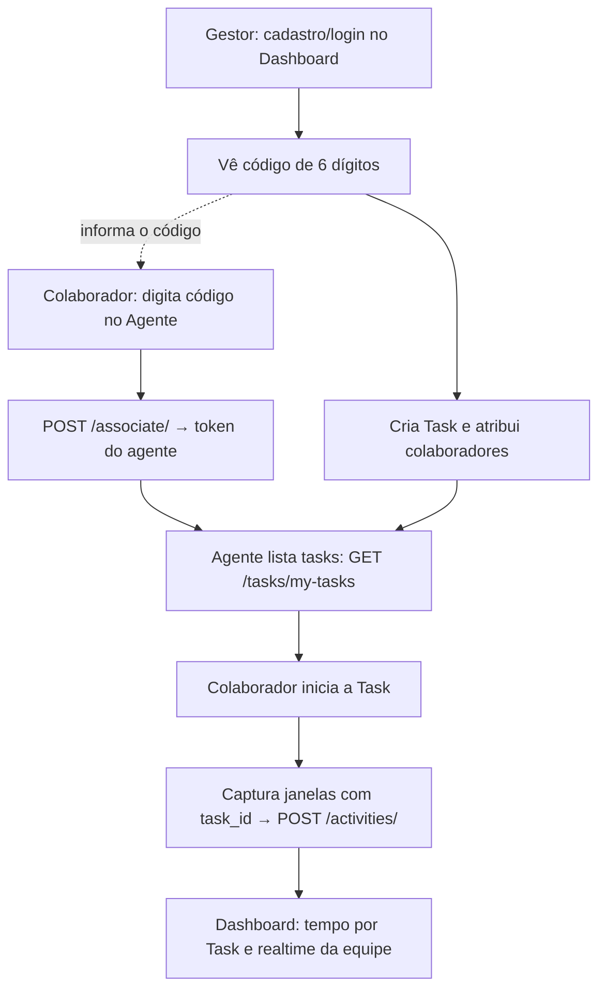

# 🚀 Plano de Execução — MVP TimeTracker (Com Tasks)

> **Regras:** trabalho direto na `main`. **Nenhum commit/push sem autorização explícita.**
> **Objetivo:** sistema utilizável por terceiros, com Agente em uma rede e Backend + Frontend em um servidor em outra rede, usando **Tasks** como unidade do monitoramento.

---

## 🔍 1. Revisão contra o código real (13/10)

O plano anterior partia de pressupostos. A leitura do código mostrou lacunas que **bloqueiam** o MVP:

| # | Achado no código | Impacto | Correção no plano |
| :-- | :-- | :-- | :-- |
| 1 | **Frontend não tem login real.** [AuthPage.jsx](file:///c:/Users/Rino/Documents/DEVERES_FACULDADE/Bay_Area/TimeTracker/testes/FrontEnd/src/features/auth/pages/AuthPage.jsx) mostra "Autenticação indisponível"; [api.js](file:///c:/Users/Rino/Documents/DEVERES_FACULDADE/Bay_Area/TimeTracker/testes/FrontEnd/src/shared/api/api.js) não envia `Authorization`. (Issue #112 está fechada, mas não foi integrada.) | Sem login não há "gestor dono" de tasks nem código de associação. | **Novo bloco:** login/cadastro, sessão, guarda de rotas e header Bearer. |
| 2 | **Rotas sem autenticação.** `/activities/`, `/dashboard/*`, `/users/`, `/config/` não usam `get_current_manager` nem token do agente. (Issue #118 diz "rota autenticada", mas o código não exige.) | Qualquer pessoa na internet pode enviar ou ler dados quando a API for exposta. | Proteger as rotas e filtrar tudo pela equipe do gestor. |
| 3 | **Não há migrações.** [main.py](file:///c:/Users/Rino/Documents/DEVERES_FACULDADE/Bay_Area/TimeTracker/testes/backend/app/main.py) usa `create_all`, que **não adiciona colunas** em tabelas existentes. | `association_code`, `manager_id` e `task_id` quebram bancos já criados. | Documentar reset do banco (`docker compose down -v`) para o MVP. Alembic fica para depois. |
| 4 | **JWT expira em 60 min** e só aceita audiência `time-tracker:manager` ([security.py](file:///c:/Users/Rino/Documents/DEVERES_FACULDADE/Bay_Area/TimeTracker/testes/backend/app/security.py)). O agente não tem refresh. | Agente pararia de enviar dados 1h depois de associado. | Token do agente com audiência própria (`time-tracker:agent`) e validade longa. |
| 5 | **`JWT_SECRET_KEY` vazia gera chave nova a cada restart.** | Todo restart da API invalida todos os agentes associados. | Tornar obrigatória no `.env` do servidor. |
| 6 | **Agente não trata 401** no envio da fila. | Token inválido → fila cresce para sempre, sem aviso ao usuário. | Em 401: limpar associação e reabrir o formulário. |
| 7 | **Identidade por `username` global único** (`User.username unique`). | Dois PCs com o mesmo usuário Windows (ex.: `admin`) viram a mesma pessoa. | `POST /activities/` passa a usar o `user_id` do token, não o `username` do payload. |
| 8 | **Fila local do agente é SQLite** (`CREATE TABLE IF NOT EXISTS`). | Adicionar `TaskId` não altera filas já existentes. | `ALTER TABLE` condicional no `Initialize()`. |
| 9 | **Captura começa logo após associar.** | Contraria a regra "sem task ativa, sem monitoramento". | `CaptureService` só enfileira com task ativa. |
| 10 | **Só a API seria exposta no túnel.** | O gestor em outra rede também precisa abrir o Dashboard. | Expor também o Frontend (build com `VITE_API_URL` público). |
| 11 | Caminhos errados no plano anterior (`src/services/api.js`). | — | Correto: `src/shared/api/api.js`. `AssociationCodeCard` **já existe** (só está oculto). |
| 12 | Testes do frontend validam as mensagens de "indisponível" (ex.: [TasksPage.test.jsx](file:///c:/Users/Rino/Documents/DEVERES_FACULDADE/Bay_Area/TimeTracker/testes/FrontEnd/src/features/tasks/pages/TasksPage.test.jsx)). | Mexer nas telas quebra esses testes. | Atualizar os testes junto com as telas. |

> [!WARNING]
> **Coordenação com a equipe:** os itens 1, 2 e 12 alteram arquivos do Carlos (frontend) e do Dannyel (backend/auth). Vale avisar os dois antes, para que ninguém trabalhe nos mesmos arquivos em paralelo.

---

## 🎯 2. Fluxo alvo

---

## 🛠️ 3. Blocos de execução

### Bloco 1 — Backend (base de segurança + tasks)
- [ ] **Modelos:** `Manager.association_code` (6 dígitos, único), `User.manager_id`, `Task`, `task_assignments` (N:N), `ActivityLog.task_id` (`ondelete=SET NULL`).
- [ ] **Segurança:** `create_agent_token` / `get_current_agent` (audiência `time-tracker:agent`, validade longa); manter o token do gestor como está.
- [ ] **Rotas novas:** `GET /auth/me`, `POST /associate/` (contrato atual do agente: `code`, `username`, `hostname` → `token`), CRUD `/tasks/`, `GET /tasks/my-tasks`.
- [ ] **Rotas existentes protegidas e filtradas por equipe:** `POST /activities/` (agente; valida se a task pertence ao colaborador), `/activities/realtime`, `/dashboard/*`, `/users/` (gestor), `GET /config/` (agente ou gestor), `PUT /config/` (gestor).
- [ ] **Dashboard:** agregação de tempo por task.
- [ ] **Seed/env:** `.env.example` com `JWT_SECRET_KEY` obrigatória; nota de reset do banco no README.
- [ ] **Testes:** pytest para associação, tasks, isolamento entre gestores e rotas sem token (401).

### Bloco 2 — Frontend (login + tasks + dados reais)
- [ ] **Auth:** formulário real em `AuthPage` (`/auth/register`, `/auth/login`), token em `sessionStorage`, guarda de rotas e logout.
- [ ] **api.js:** header `Authorization`, tratamento de 401 (volta ao login) e métodos `me`, `tasks`, `createTask`, `updateTask`, `deleteTask`.
- [ ] **Contratos:** atualizar `contracts` e `validators` (o projeto valida tipos com `npm run typecheck`).
- [ ] **Dashboard:** reexibir `AssociationCodeCard` com o código vindo de `/auth/me`; filtro e gráfico de tempo por task.
- [ ] **TasksPage:** listar, criar, editar, excluir e atribuir colaboradores.
- [ ] **Testes:** atualizar os testes afetados; rodar `npm run check`.

### Bloco 3 — Agente C#
- [ ] **DTOs/Modelos:** `TaskDto`; `TaskId` em `ActivitySample` e `ActivityLogCreateDto`.
- [ ] **Fila SQLite:** coluna `TaskId` com `ALTER TABLE` condicional.
- [ ] **ApiClient:** `GetMyTasksAsync()`.
- [ ] **Captura:** só enfileira com task ativa; status "Aguardando task" quando não houver.
- [ ] **UI:** submenu "Tasks" na bandeja (iniciar/trocar/encerrar) e task ativa no `StatusForm`.
- [ ] **401:** limpar associação e reabrir o `AssociationForm`.
- [ ] **Validação:** `dotnet build`.

### Bloco 4 — Rede e teste ponta a ponta
- [ ] Servidor: definir `JWT_SECRET_KEY`, subir com Docker e fazer build do front com `VITE_API_URL` público.
- [ ] Túnel HTTPS (Cloudflare Tunnel ou Ngrok) para **API e Frontend**.
- [ ] Agente: `BaseUrl` público e `RequireHttps: true`.
- [ ] Roteiro: cadastro → código → associação em outro PC → criar task → iniciar no agente → dados no dashboard → reiniciar a API e confirmar que o agente continua autorizado.

---

## ⏱️ 4. Estimativa realista (sozinho, com IA)

| Bloco | Tempo |
| :-- | :-- |
| 1. Backend | 2h – 3h |
| 2. Frontend | 2h – 3h |
| 3. Agente | 1h30 – 2h |
| 4. Rede + testes | 1h |
| **Total** | **~6h30 – 9h** |

> [!IMPORTANT]
> Com o login do frontend e a proteção das rotas incluídos, **uma única noite fica apertada**. Se faltar tempo, a ordem de corte sugerida é: deixar edição/exclusão de tasks e o gráfico por task para depois e manter o fluxo principal (criar task → iniciar no agente → ver no dashboard).
